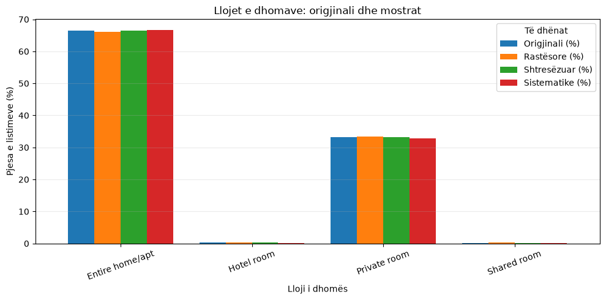
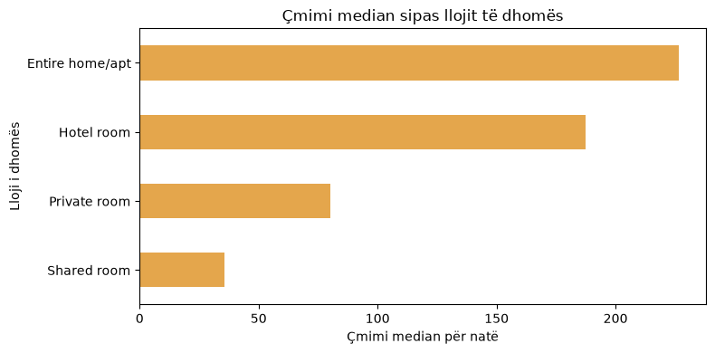
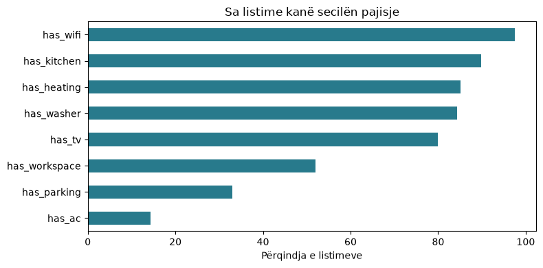
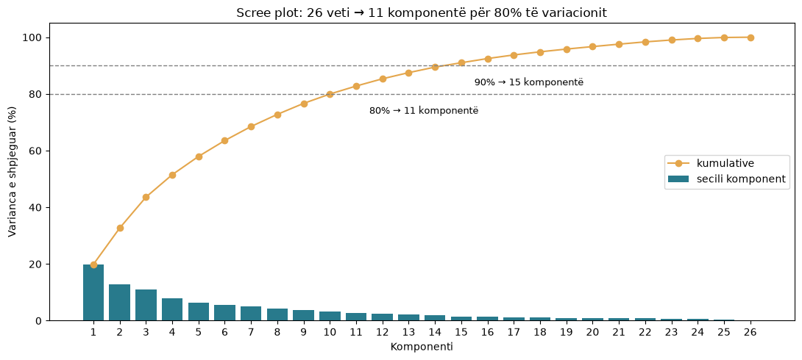

| | |
|:---:|:---|
| <a href="https://commons.wikimedia.org/wiki/File:University_of_Prishtina_logo.svg"></a> | **Universiteti i Prishtinës**<br>Fakulteti i Inxhinierisë Elektrike dhe Kompjuterike<br>Inxhinieri Kompjuterike dhe Softuerike — Programi Master<br>**Profesori:** Dr. Sc. Mërgim H. HOTI<br>**Asistenti:** Blend Berisha<br>**Lënda:** Përgatitja dhe vizualizimi i të dhënave |

# London Airbnb Listings · Para-procesimi (Pjesa I)

Ky projekt paraqet përgatitjen e të dhënave të listimeve Airbnb në Londër për analizën e çmimeve.

**Pyetja:** Si ndryshon çmimi për natë i listimeve Airbnb në Londër sipas llojit të dhomës, lagjes dhe kapacitetit?

Të dhënat janë nga [Inside Airbnb](https://insideairbnb.com/get-the-data/), snapshot-i i Londrës i **17 shtatorit 2026**. Një rresht në `listings.csv.gz` përfaqëson një listim. Projekti mbulon inspektimin, pastrimin, integrimin, krijimin dhe zgjedhjen e vetive për analizën e çmimit.

## Përmbajtja

| Notebook-u | Çfarë përmban |
|---|---|
| [01 · Inspektimi dhe kualiteti](notebooks/01_inspektimi_dhe_kualiteti.ipynb) | Burimi dhe tipet e të dhënave, statistikat përshkruese, mungesat, dublikatat, anomalitë, tri metoda mostrimi dhe agregimet. |
| [02 · Pastrimi dhe integrimi](notebooks/02_pastrimi_dhe_transformimi.ipynb) | Korrigjimi i tipeve, integrimi me komentet dhe kalendarin, trajtimi i mungesave dhe çmimeve ekstreme, tabela e analizës. |
| [03 · Krijimi i vetive](notebooks/03_krijimi_vetive_dhe_kodimi.ipynb) | Veti të reja për vendndodhjen, host-in dhe pajisjet; grupimi i kategorive, diskretizimi, binarizimi dhe kodimi one-hot. |
| [04 · Transformimi dhe reduktimi](notebooks/04_transformimi_dhe_reduktimi.ipynb) | Logaritmi dhe rrënja katrore, min-max dhe z-score, zgjedhja sipas korrelacionit dhe variancës, PCA dhe tabela finale. |

Për të gjithë rrjedhën në një skedar, përdorni [para_procesimi.ipynb](notebooks/para_procesimi.ipynb). Ai bashkon katër notebook-et në rendin 01 → 02 → 03 → 04 dhe përmban rezultatet e ruajtura prej tyre.

Shpjegimet, tabelat, grafikët dhe përfundimet janë brenda notebook-eve. Grafikët nuk ruhen veçmas si imazhe.

## Si të filloni

Hapni terminalin në dosjen `pvdh_group_10`. Nevojitet **Python 3.10+**. Instaloni paketat e `requirements.txt` dhe nisni JupyterLab:

**Windows (PowerShell)**

```powershell
py -3 -m venv .venv
.\.venv\Scripts\Activate.ps1
python -m pip install -r requirements.txt
python -m jupyter lab
```

**Linux / macOS (bash ose zsh)**

```bash
python3 -m venv .venv
source .venv/bin/activate
python -m pip install -r requirements.txt
python -m jupyter lab
```

Në JupyterLab zgjidhni kernel-in Python të mjedisit `.venv` dhe hapni dosjen `notebooks/`.

### Të dhënat

Shkarkoni **të tre** skedarët e të njëjtit snapshot në `dataset/`. Notebook-u 02 ka nevojë për `reviews.csv.gz` dhe `calendar.csv.gz`; vetëm `listings.csv.gz` nuk mjafton.

**Windows (PowerShell)**

```powershell
$base = 'https://data.insideairbnb.com/united-kingdom/england/london/2026-09-17/data'
New-Item -ItemType Directory -Force dataset | Out-Null
curl.exe -L --fail --output dataset/listings.csv.gz "$base/listings.csv.gz"
curl.exe -L --fail --output dataset/reviews.csv.gz "$base/reviews.csv.gz"
curl.exe -L --fail --output dataset/calendar.csv.gz "$base/calendar.csv.gz"
```

**Linux / macOS (bash ose zsh)**

```bash
base='https://data.insideairbnb.com/united-kingdom/england/london/2026-09-17/data'
mkdir -p dataset
curl -L --fail --output dataset/listings.csv.gz "$base/listings.csv.gz"
curl -L --fail --output dataset/reviews.csv.gz "$base/reviews.csv.gz"
curl -L --fail --output dataset/calendar.csv.gz "$base/calendar.csv.gz"
```

Skedarët origjinalë dhe CSV-të e krijuara nga notebook-et janë në `.gitignore` për shkak të madhësisë së tyre. Notebook-et nuk i ndryshojnë skedarët origjinalë.

### Rendi i notebook-eve

Ekzekutoni qelizat e secilit notebook nga fillimi në fund:

1. **01 · Inspektimi:** lexon `dataset/listings.csv.gz` dhe shfaq tabelat e grafikët brenda notebook-ut. Nuk krijon CSV.
2. **02 · Pastrimi:** lexon `listings.csv.gz`, `reviews.csv.gz` dhe `calendar.csv.gz`; krijon `dataset/listings_clean_full.csv` dhe `dataset/listings_preprocessed.csv` (18 kolona për analizë).
3. **03 · Krijimi i vetive:** lexon `listings_clean_full.csv` dhe krijon `dataset/listings_features.csv`.
4. **04 · Transformimi dhe reduktimi:** lexon `listings_features.csv` dhe krijon `dataset/listings_transformed.csv` dhe `dataset/listings_model_ready.csv`.

Për rrjedhën e plotë ekzekutoni **01 → 02 → 03 → 04** në këtë rend. Notebook-u 01 mund të hapet edhe më vete; notebook-et 03 dhe 04 lexojnë CSV-të e krijuara nga hapat para tyre. Mund t'i ekzekutoni veçmas ose të hapni `para_procesimi.ipynb` dhe t'i ekzekutoni të gjitha qelizat e tij nga fillimi në fund.

## Rezultati kryesor

- `listings.csv.gz`: **91,954 listime × 90 kolona**.
- Integrimi përdor **2,323,969 komente** dhe **33,563,890 rreshta kalendari**; listimet nuk shumëzohen nga bashkimi, sepse këto të dhëna agregohen sipas `listing_id`.
- Pas pastrimit mbeten **59,846 listime**: hiqen 32,049 pa çmim dhe 59 me çmim mbi percentilin 99.9 të llojit përkatës të dhomës.
- `listings_preprocessed.csv` ka **18 kolona** për analizë; `listings_model_ready.csv` ka **62 kolona**: ID, `price`, `price_log`, 48 veti të zgjedhura dhe 11 komponentë PCA.

### Rezultate në grafikë

**Mostrimi sipas llojit të dhomës.** Notebook-u 01 krahason shpërndarjen e llojeve të dhomave në të dhënat origjinale dhe në mostrat e rastësishme, të shtresëzuara dhe sistematike.



**Çmimi median sipas llojit të dhomës.** Pas pastrimit, çmimi median për `Entire home/apt` është 226.67, ndërsa për `Private room` është 80.00. Grafiku është nga notebook-u 02.



**Pajisjet e listimeve.** Notebook-u 03 tregon sa shpesh shfaqen vetitë binare të krijuara nga lista e pajisjeve, si Wi-Fi, kuzhina dhe parkimi.



**Reduktimi i dimensionit me PCA.** Nga 26 veti numerike, 11 komponentë shpjegojnë 82.77% të variacionit. Grafiku është nga notebook-u 04.



## Kufizime të metodës

- Rreshtat pa çmim largohen sepse çmimi është variabla kryesore; analiza e çmimit përfaqëson vetëm listimet me çmim të njohur.
- Vlerat e `bathrooms`, `bedrooms` dhe `beds` që mbeten bosh plotësohen me medianë sipas kapacitetit. Këto janë vlerësime, jo matje origjinale.
- Çmimet mbi percentilin 99.9 të secilit lloj dhome (59 listime) hiqen si të pabesueshme; ky kufi është statistikor, ndaj disa mund të ishin listime të vërteta luksoze. Çmimet mbi percentilin 99 të mbetur vetëm shënohen, nuk fshihen.
- `price_band` është krijuar nga çmimi. Nuk duhet përdorur si hyrje për një model që parashikon çmimin; për të njëjtën arsye duhen përjashtuar `price_quote_*` dhe `estimated_revenue_l365d` (saktësisht çmimi × zënia e vlerësuar).
- Vlerësimet dhe datat e komenteve mbeten bosh për listimet pa komente. Edhe disa vlera të netëve minimale/maksimale mbeten bosh; tabela finale kërkon trajtim të mëtejshëm të këtyre mungesave nëse përdoret për modelim.
- Edhe `price_per_person` është nxjerrë nga çmimi. Përdoret vetëm për përshkrim dhe përjashtohet nga nënbashkësia finale.
- Flamujt e pajisjeve (`has_wifi`, `has_parking` etj.) gjenden me fjalë kyçe në tekstin e lirë të host-eve; shkrime të rralla mund të mos kapen.
- `borough_frequency`, min-max, z-score dhe PCA llogariten mbi të gjitha listimet e disponueshme për qëllimin përshkrues. Për një model parashikues, ndajini fillimisht të dhënat në trajnim/test dhe llogaritni këto statistika vetëm te trajnimi. `listings_model_ready.csv` i ruan vetitë numerike të transformuara, por të pashkallëzuara; komponentët e ruajtur të PCA janë për analizë eksploruese.
- PCA përdor vetëm listimet me të gjitha vlerat numerike (**47,317 nga 59,846**). Komponentët PCA mungojnë për 12,529 listimet e tjera, kryesisht për shkak të mungesës së komenteve ose të disa vlerave të netëve.
- Kufijtë e zgjedhjes së vetive (|ρ| ≥ 0.8 për korrelacionin, mbi 98% për vlerën më të shpeshtë) dhe radha e kolonave brenda grupeve janë zgjedhje të zakonshme, jo rregulla absolute. Me kufij të tjerë, nënbashkësia do të ndryshonte pak.

## Kontribuesit

- [Alketa Zekaj](https://github.com/AlketaZekaj)
- [Yllka Berisha](https://github.com/yllkeberisha)
- [Zana Ademi](https://github.com/Zanaad)
